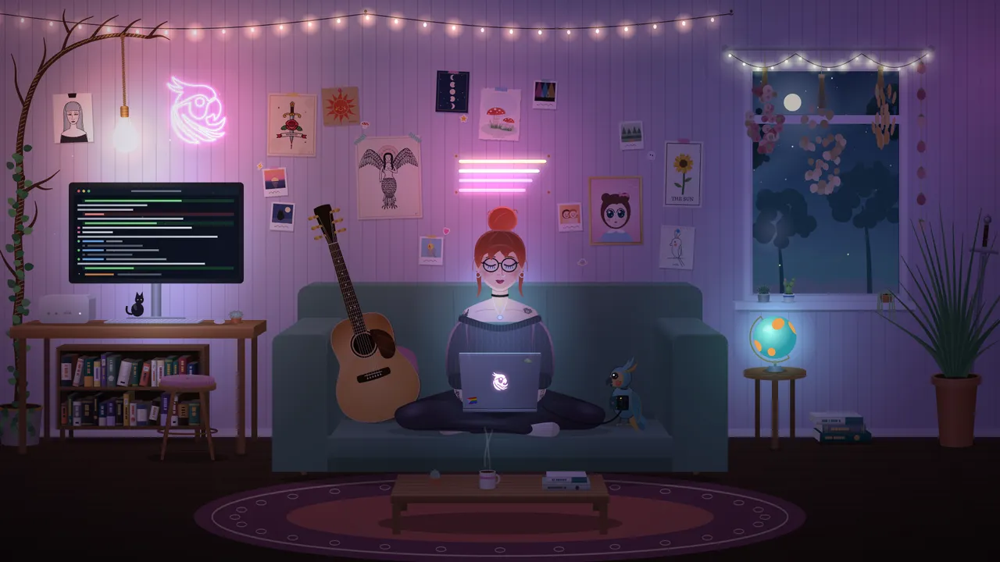

# code-drawn-scenes

<p align="center">
  
</p>
<p align="center"><sub>A 16-second seamless loop, every pixel drawn in code. The scene these guidelines were distilled from. <a href="assets/room-1080p.mp4">1080p MP4</a></sub></p>

A skill for Claude Code (and other Agent Skills runtimes) for building code-drawn illustrated scenes, in Canvas2D, SVG
or WebGL-2D, that look finished on the first pass. It covers interiors, streets, landscapes, still lifes, game art,
hero banners and ambient animated loops.

Most first-pass scenes fail on *correctness*, not drawing skill: no shared vanishing point, floating or impossible
objects, wrong overlaps, placeholders, crammed placement. This skill makes the agent plan the camera, light, layout
and draw order as data first, build every element finished, and review its own render zoomed in until a full pass is
clean. It also covers how to brief an independent subagent to do the whole build in one go.

## Install
```sh
git clone git@github.com:peculiar-ragdoll/code-drawn-scenes.git ~/.claude/skills/code-drawn-scenes
```

## Files
| file | what |
|---|---|
| `SKILL.md` | trigger, workflow, quick reference, common mistakes |
| `art-direction.md` | offering the references-or-best-effort choice up front, what each kind of reference gives, the art-direction note |
| `figures.md` | building figures from a skeleton: proportions, weight and contact, poses that usually go wrong, hands and faces |
| `reviewer.md` | the adversarial reviewer: persona, code checks (depth order against draw order, reflections, text), pixel checks, report format |
| `briefing.md` | delegating the build to an independent subagent: brief shape, a verbatim example, isolation |
| `perspective.md` | choosing a projection, the ground-contact table, visible faces, recipes (boxes, lying items, rounded forms, circles) |
| `lighting.md` | layered pipeline (scene layer, light map, glows), occlusion, shadows, gentle light animation |
| `plausibility.md` | support and contact, mechanics and pivots, construction, draw order, overlaps |
| `composition.md` | placement, spacing, eye-level clusters, balance, framing |
| `detail.md` | finishing every element: subject, material, construction, attachment, story detail |
| `review.md` | the render → zoom → list → fix loop, checklist, stale-render and export notes |
| `scene-kit.js` | Canvas2D toolkit: shared-VP projection, box / lyingFlat / cylinder helpers, tangent silhouettes, light map, flicker, mount loop |
| `zoom.html` | inspect any region of a scene page at 3–5× |
