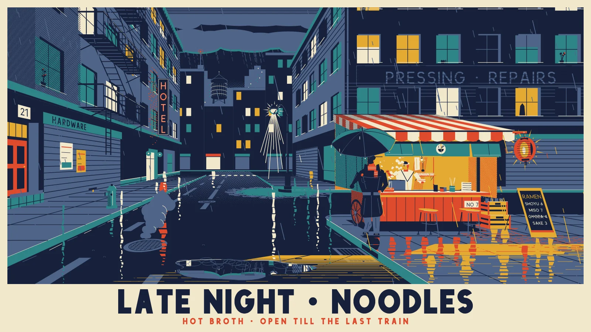

# code-drawn-scenes

<p align="center">
  
</p>
<p align="center"><sub>A 16-second seamless loop, every pixel drawn in code. The scene these guidelines were distilled from. <a href="assets/room-1080p.mp4">1080p MP4</a></sub></p>

A skill for Claude Code (and other Agent Skills runtimes) for building code-drawn illustrated scenes, in Canvas2D, SVG
or WebGL-2D, that look finished on the first pass. It covers interiors, streets, landscapes, still lifes, game art,
hero banners and ambient animated loops.

Most first-pass scenes fail on *correctness*, not drawing skill: no shared vanishing point, floating or impossible
objects, wrong overlaps, placeholders, crammed placement. This skill makes the agent plan the camera, light, layout
and draw order as data first, build every element finished, and review its own render zoomed in until a full pass is
clean. It also covers how to brief an independent subagent to do the whole build in one go.

## Examples

<p align="center">
  
</p>
<p align="center"><sub><b>Last Bowl</b>, made with the skill in one go: an independent builder from a brief and six reference
images, then two rounds of adversarial review and fresh fix passes. Animated rain, steam and lantern light.
<a href="examples/last-bowl/scene.html">Scene</a> · <a href="examples/last-bowl/brief.md">brief</a> ·
<a href="examples/last-bowl/CREDITS.md">reference credits</a></sub></p>

More examples are in [`examples/`](examples/).

## Install
```sh
git clone git@github.com:peculiar-ragdoll/code-drawn-scenes.git ~/.claude/skills/code-drawn-scenes
```

## Files
| file | what |
|---|---|
| `SKILL.md` | trigger, workflow, quick reference, common mistakes |
| `art-direction.md` | offering the references-or-best-effort choice up front, what each kind of reference gives, the art-direction note |
| `figures.md` | building figures from a skeleton: proportions, weight and contact, poses that usually go wrong, hands and faces |
| `context.md` | working in passes that each fit one context: the folder as memory, `NOTES.md`, modules, image budget, fresh fix passes |
| `checks.md` | proving the geometry in code: world camera, registering elements as drawn, support / join / depth-order / reflection / text checks |
| `reviewer.md` | the adversarial reviewer: the loop and when to stop, persona, severity, code checks, pixel checks, report format |
| `briefing.md` | delegating the build to an independent subagent: brief shape and scene size, keeping it neutral, isolation, the fix-pass brief |
| `perspective.md` | choosing a projection, the ground-contact table, visible faces, recipes (boxes, lying items, rounded forms, circles) |
| `lighting.md` | layered pipeline (scene layer, light map, glows), occlusion, shadows, gentle light animation |
| `plausibility.md` | support and contact, mechanics and pivots, construction, draw order, overlaps |
| `composition.md` | placement, spacing, eye-level clusters, balance, framing |
| `detail.md` | finishing every element: subject, material, construction, attachment, story detail |
| `review.md` | the render → zoom → list → fix loop, checklist, stale-render and export notes |
| `scene-kit.js` | Canvas2D toolkit: world camera, scene checks, shared-VP projection, box / lyingFlat / cylinder helpers, tangent silhouettes, light map, flicker, mount loop |
| `world-kit.js` | optional perspective helper: pinhole, parallel and isometric cameras; boxes, faces, cylinders and circles in world units with automatic visible faces; shading from orientation; cast shadows; mirror-pass reflections; a depth queue; automatic check registration |
| `tools/render.mjs` | the render-and-check runner: serves the folder with caching off, renders given times, saves the full frame, zoomed tiles and crops, prints check failures and console errors |
| `zoom.html` | inspect any region of a scene page at 3–5× |
| `examples/` | scenes made with the skill, for people to look at (not for builders: see its README) |

## Editing the skill
State every rule in terms of geometry, light and the camera: depth, support, enclosure, reflection, pivots. Don't name
scene objects, even as examples, and don't add defects from a particular test scene. A named example reads as a
suggestion, and builders start putting that element in every scene.
